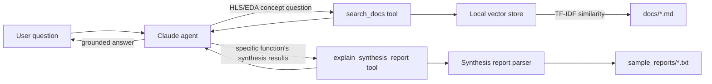

# HLS Docs Agent

A small retrieval-augmented generation (RAG) agent that answers questions about
High-Level Synthesis (HLS) and EDA workflows, and can read and explain HLS synthesis
reports. Built as a focused, honest demonstration of LLM API integration, multi-tool
agent design, and a retrieval pipeline — the pieces of a modern "AI agent" stack.

## Why this exists

Most CV bullets about "AI experience" mean "I used Copilot." This project is the next
step: actually calling an LLM API, giving it tools it decides when to use, grounding its
answers in real documents and real synthesis output instead of letting it guess.

## Provenance and limitations (read this first)

This is a learning prototype. To be clear about what it is and is not:

- **The notes in `docs/` are general HLS/EDA concepts** (pipelining, scheduling,
  resource sharing, verification, agent design). They are **not** Cadence or Stratus
  documentation and were not checked against a production documentation set.
- **AI helped draft the notes and the sample synthesis report.** I read and worked
  through the material myself, but I did not write it all from scratch.
- **The synthesis report is illustrative.** `sample_reports/fir_filter_report.txt` imitates
  the general shape of an HLS report; it is not output from Stratus or any real tool run.
  The parser (`src/synthesis_report.py`) was written partly by me and partly completed with
  AI assistance, and would need extending against real reports.
- **I have no hands-on Stratus experience.** My understanding of HLS is at beginner level
  (scheduling decides when operations happen; pipelining overlaps them to raise
  throughput; there are trade-offs between latency, throughput and area).
- **Retrieval is keyword-based (TF-IDF), not semantic.** See the evaluation below.

## Evaluation

`python -m src.evaluate` runs 15 questions against the 10 chunks in the store and checks
whether the expected source file is retrieved. Measured results:

| Subset | Questions | recall@1 | recall@3 |
| --- | --- | --- | --- |
| Direct (uses the notes' wording) | 11 | 91% | 100% |
| Paraphrased (different wording) | 4 | 75% | 100% |
| All | 15 | 87% | 100% |

How to read this: the questions were written by me against the same three notes, and the
store holds only 10 chunks, so recall@3 is easy to reach and says little. **recall@1 is the
more informative number**, and it drops on paraphrased questions, which is the expected
weakness of keyword matching. The next step would be sentence embeddings and a larger,
independently written question set.

## Architecture



1. **Ingestion** (`src/ingest.py`): every markdown file in `docs/` is chunked into
   paragraph-sized pieces.
2. **Vector store** (`src/vectorstore.py`): chunks are embedded with TF-IDF (scikit-learn)
   and stored in a local Chroma collection — fully offline, no embedding API or model
   download required.
3. **Synthesis report parser** (`src/synthesis_report.py`): parses a text-based HLS
   synthesis report (timing, latency, resource utilization) into a structured summary
   the agent can reason over.
4. **Agent** (`src/agent.py`): Claude is given two tools — `search_docs` for general
   HLS/EDA questions, and `explain_synthesis_report` for questions about a specific
   synthesis run. It decides for itself which tool (if any) a question needs, inspects
   the results, and can call another tool before producing a final, source-cited answer.
5. **CLI** (`src/cli.py`): a simple chat loop to try it interactively.

## Using a real synthesis report instead of the sample

`sample_reports/fir_filter_report.txt` is an illustrative report matching the general
shape of a Vitis HLS `_csynth.rpt` file, used here because this project doesn't have a
licensed HLS tool available to generate one live. To use a real one:

1. Run HLS synthesis on a small design with a tool such as Vitis HLS (free WebPACK
   license) or an open-source alternative like Bambu HLS.
2. Copy the generated report into `sample_reports/<function_name>_report.txt`.
3. Ask the agent about `<function_name>` — `explain_synthesis_report` will load it
   automatically. If the real report's formatting differs, extend the regexes in
   `synthesis_report.py`'s `load_report()` to match.

## Setup

```bash
pip install -r requirements.txt
cp .env.example .env   # then add your ANTHROPIC_API_KEY
```

## Run it

```bash
python -m src.cli
```

Illustrative session (real answers vary in wording and length):

```
> What is loop pipelining?
(Explains that pipelining overlaps loop iterations to raise throughput at the cost of
area, citing hls_basics.md.)

> Why wasn't fir_loop pipelined?
(Calls explain_synthesis_report, reads the sample report, and says the loop was not
pipelined and that a PIPELINE directive would reduce the initiation interval at the
cost of extra DSP/FF usage.)
```

Note: answers sometimes add general HLS knowledge beyond the retrieved notes (for
example tool-specific pragma names). A groundedness check that flags claims not found
in retrieved text is a planned improvement.

## Run the tests

```bash
pytest tests/ -v
```

The suite covers the retrieval pipeline, the synthesis report parser, and the agent's
tool-call loop (via a mocked Anthropic client) — all three layers verified without
requiring a live API key or network access.

## Extending it

- Swap the TF-IDF embeddings in `vectorstore.py` for a proper sentence-embedding model
  for better semantic matching.
- Add a `read_source_code` tool so the agent can correlate a synthesis report's resource
  usage back to specific lines of the original C++.
- Package a specific question pattern as a reusable "skill"/slash command, per the
  pattern described in `docs/ai_agents_for_eda.md`.

